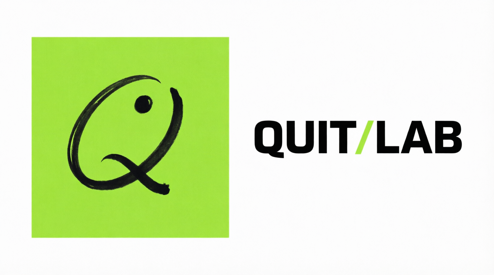
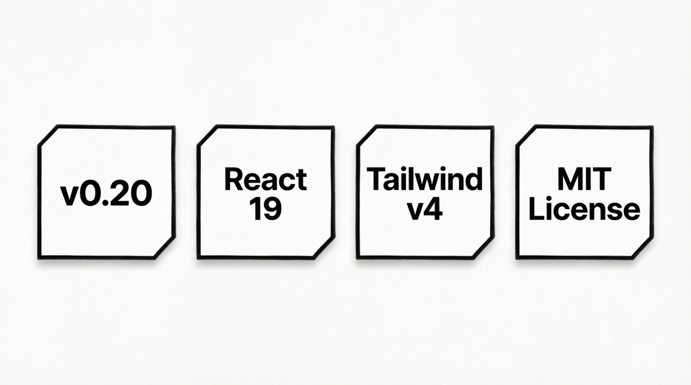

<p align="center">
  
</p>
<h1 align="center">Quit Initiative</h1>
<p align="center">
  <em>Quit the habit. Own the person.</em><br />
  Science-backed quit plans, built for students, by students.
</p>

<p align="center">
  
  &nbsp;
  
</p>

<p align="center">
  <strong>v0.20 — the Quit Lab design.</strong> This copy lives on GitHub so you can explore
  and try everything before it ships for real. A <strong>full membership is coming soon</strong>.
  Until then: use <strong>Anonymous mode</strong> and your progress stays on your device.
</p>

---

## Status — where we are right now

We're collecting data, enhancing the service, and inviting new members to test
our products:

- **Collecting data** — preview sessions feed the protocols: on-device
  anonymous progress, member feedback and usage signals, so every flow and
  every claim is measured before launch.
- **Enhancing the service** — the site just moved to the new Quit Lab design
  (ink + lime, mono/serif type, sticky mobile navigation, route-level code
  splitting) and the product behind it improves release by release.
- **Inviting new members** — we're opening the preview to more testers. Join
  anonymously, break a habit, tell us what breaks: founding testers and
  volunteers get verified certificates, digital badges and a real say in what
  ships next.

## Brand — the Quit Lab logo

<p align="center">
  
</p>

Two logos carry the identity, both set in the lab's mono type on ink
(`#0a0a0a`) with the lime accent (`#a3e635`):

- **Homepage / navbar — the new lockup** (shown at the top of this README):
  a lime square mark holding the hand-drawn curve-and-dot glyph in ink, locked
  to the mono wordmark `QUIT⁄LAB` with the `⁄` divider in lime. It sits in the
  sticky navbar on every public page and in the app shell, always on the ink
  bar.
- **Footer — the lab logo at full width:** the oversized `Quit⁄Lab` wordmark
  stretched edge to edge along the bottom of the footer, drawn in the border-ink
  tone so it reads as a watermark, with the `⁄` again in lime.

---

> **Note:** Quit is still under active development. The product, its features, and
> its pricing are not final. Some services that are currently free may include a fee
> in the future. Everything shown here is a preview and subject to change before
> launch.

## The Mission

<p align="center">
  
</p>

Addiction — smoking, vaping, doom-scrolling, cannabis, gambling, gaming, junk
food, porn, procrastination — costs students their time, money and health.
Most "quit" apps sell willpower myths. Quit does the opposite:

- **Peer-reviewed** — every protocol links to its published source on
  ResearchGate, Nature, PubMed, NIH and more. No shame, just science,
  translated into tools a student can actually use this semester.
- **Streaks that stock** — "days clean", money saved, milestones: your progress
  becomes hard to argue with.
- **The Academy** — videos, articles and materials that build resistance to each
  type of addiction before the urge lands.
- **A community** — student circles, creator streams, live accountability (Phase 3).
- **Seek help** — a support hub with 1-tap crisis lines for Tunisia (ATPS, Razi,
  UNICEF) and the US & Canada (988), WHO-sourced mental-health content, and
  members who got help. Member stories are **mockup details** for now — real
  stories arrive with the **real-accounts feature**, which is coming soon.
  The story data lives in `src/data/member-stories.ts`, the single source ready
  for backup/live integration.
- **Global Volunteer Program** — join the Quit Initiative as a volunteer. Peer
  support, campus outreach, and content creation roles across 6 countries.
- **Quit Lab** — the research engine: AI, data science and community fieldwork
  translated into accessible content in +5 languages. Visit `/research` to
  explore our domains, methodology and volunteer opportunities. The home page
  opens with an autoplaying **Quit Lab intro video** inside the hero — muted,
  with a pulsing now-playing pill and a "Watch on YouTube" fallback — so
  visitors watch the pitch before scrolling on.
- **Quit Blog** — the official release channel of the lab: releases, research
  notes and project outcomes, opening with an animated **pure-CSS orbit** of the
  modern world's most addictive patterns. Visit `/blog`.
- **Sticky, mobile-first shell** — the public navbar stays stuck to the top, the
  app gets a sticky top bar plus a safe-area-aware fixed bottom nav, and a
  sticky mobile action bar keeps *Log in / Join the lab* one tap away.
- **Ink-first design** — dark (`#0a0a0a` ink + `#a3e635` lime) is the standard
  theme across the whole website. The light theme and its toggle were removed;
  every page ships in Quit Lab ink mode.

> "A failure to quit is not a failure of the person. Relapse is a data point,
> not a verdict." — the Quit mindset

## Research at Quit Lab

<p align="center">
  
</p>

Quit Lab is the research and development arm of Quit Initiative — a space
where data science, AI and community-driven fieldwork come together to
understand addiction and turn that understanding into tools, content and
education that anyone with a phone can access.

### What we research

We formulate hypotheses on current market and population trends across the
behaviours that erode health and potential the most:

- **Gambling** — risk factors and the growing overlap with online platforms.
- **Alcohol addiction** — prevalence, cultural drivers and digital interventions.
- **Drug use & substance abuse** — dependency trends, harm reduction, recovery data.
- **Cannabis** — shifting legal landscapes, usage patterns and long-term health impact.
- **Tobacco** — prevalence tracking, cessation programs, campaign reach.
- **Vaping** — e-cigarette growth, youth-targeted marketing, emerging health data.
- **Addiction to Reels & Doom-Scrolling** — short-form content loops, algorithmic amplification, mental-health toll.
- **Time & Health-Wasting Phenomena** — screen time, sedentary behaviours, passive entertainment.

### How we do it

- **Hypothesis-driven research** — every study starts with a clear question and
  transparent methodology that others can replicate and challenge.
- **Research & Statistics** — from survey design to longitudinal analysis, we
  produce findings that inform both academic discourse and public-health strategy.
- **AI, Data Science & Machine Learning** — we build models that detect at-risk
  individuals early, flag health misinformation, predict relapse risk and help
  clinicians allocate resources where they're needed most. Every system adheres
  to ethical guidelines and data-protection standards.
- **Research Translation** — peer-reviewed papers don't save lives sitting in
  journals. We translate findings into promotional graphics, short-form videos,
posters, infographics and audio explainers — in **English, French, German,
Arabic and Tunisian Dialect**.
- **Training & Education** — we use our research to elevate the cognitive level
  of communities: educating through structured learning paths, empowering through
  workshops and mentorship, and enabling through real projects and campaigns.

### Volunteer with Quit Lab

We encourage Medical, Nursing, Health and all allied students to volunteer with
Quit Lab & Quit Initiative. Drive awareness on your campus, earn verified
certificates and digital badges, and grow with a community that puts health
first. Peer support, campus outreach, content creation — pick the role that fits
you.

👉 **[Join the Global Volunteer Program](https://hyperxhelper.github.io/Quit/#/app/volunteer)**

👉 **[Explore Quit Lab](https://hyperxhelper.github.io/Quit/#/research)**

## Quit Blog

**Quit Blog** is the official publishing channel of Quit Initiative &
Research Lab — where release notes, research findings and the general
outcomes of the project are shared openly with the community. It launches
at **0** and grows with every published post, so the public record of the
lab grows in the open.

- **The blogging cycle** — the counter starts at 0; every release moves it
  forward. Current count: **1**.
- **"Introducing Quit Blog"** — the first post introduces the whole project:
  how Quit Initiative & Research Lab operates as a **STEM Lab** — using
  Science, Engineering, Technology and Mathematics for the favour of the
  human being and digital health.
- **A CSS orbit** — the page opens with an animated, pure-CSS orbit of the
  most addictive patterns the modern world is facing —
  doom-scrolling, short-form video, likes & validation, push notifications,
  endless gaming, vaping, gambling and nicotine — with the blogging cycle
  nested underneath. No WebGL, no three.js: it renders instantly on a phone.
- **Ink only** — dark mode is the standard theme across the whole site;
  there is no light theme and no theme toggle anymore.
- **From the lab** — written by **Ahmed Ben Abderrazek**, Registered Nurse
  and CEO of Quit Lab & Initiative. A small project from Tunisia with
  ambition to cooperate with the whole world.

👉 **[Read Quit Blog](https://hyperxhelper.github.io/Quit/#/blog)**

## Try it — Anonymous mode first.

This version is a *preview* for people checking out the initiative on GitHub
before the real release. So that no one has to leak a real-social email to test:

1. Go to the **Anonymous mode** tab on the Log in page.
2. Enter any **nickname** and a **temporary password** (4+ characters).
3. You're in — no email, no personal data, nothing to regret.

Come back later with the same nickname and password and your anonymous
progress is picked up right where you left it. A **full membership is coming
soon** — it will follow you across devices. Until then, your progress simply
stays on this device.

## What & who builds this

An open stack, an honest team:

| Area | What it does |
| --- | --- |
| **Home** | Sticky navbar, autoplaying Quit Lab intro video, streak hero, section navigation (Science, Programs, Method, Impact), research, programs, impact, volunteer & donate sections |
| **My plan** | Pick the one habit to quit, set a start date, get savings estimate |
| **Science** | Peer-reviewed sources made readable for a student |
| **Community** | Student circles, creator streams, live accountability (Phase 3) |
| **Global Volunteer Program** | Apply to volunteer — peer support, campus outreach, content creation across 6 countries |
| **Help** | Seek-help hub — crisis lines, WHO stats and member stories (mockup details until real accounts ship) |
| **Profile** | Mobile-optimised identity card, tools grid, preferences and sign-out |
| **Academy** | Video + article lessons that build resistance, type by type |
| **Clothing** | Student-only merch that makes quitting visible |
| **Our Code** | The constitution — how we support and care about each other |
| **Quit Lab** | Research division — domains, AI/ML in health, translation, training and volunteer program |
| **Quit Blog** | Official blog — pure-CSS pattern orbit, blogging cycle counted from 0, first release "Introducing Quit Blog" |
| **Settings** | Profile, privacy, notifications — tucked under Profile |

## Tech stack

<p align="center">
  
</p>

- React 19 + TypeScript + Vite
- Tailwind CSS v4 + shadcn/ui (ink-only dark theme tokens)
- React Router v7 (HashRouter — works on GitHub Pages)
- Route-level code splitting with `React.lazy`; no three.js — every visual is CSS/SVG
- Lucide icons
- Zod (form validation)
- Local-first auth (concept-safe hashing), backend pipeline at launch.

## Getting started

```bash
npm install
npm run dev
```

Production check:

```bash
npm run lint
npm run build
npm run preview
```

## Project structure

```
src/
  components/
    landing/      # hero, marquee, pillars, research-lab, programs, method, impact, philosophy, volunteer, donate
    layout/       # sticky public navbar + footer
    auth/ brand/ ui/   # auth layout, logo lockup, shadcn/ui pieces
  hooks/          # reveal — scroll-in animation, reduced-motion aware
  pages/          # one file per route
  lib/            # auth, zod schemas, section-nav helpers, addiction helpers
  data/           # data sources ready for backup/live integration (e.g. member-stories)
media/            # logo, README badges & brand imagery (ink & lime)
```

## Key improvements

### v0.20
- **New Quit Lab design** — full migration to the ink & lime system: palette
  (`#0a0a0a` ink, `#141414` ink-2, `#a3e635` lime), Inter + JetBrains Mono +
  Instrument Serif, sharp corners, grid-paper sections, mono `§` eyebrows and
  serif-italic accents across the landing, blog, research, code, auth and every
  in-app page.
- **New logos** — the navbar lockup (`QUIT⁄LAB` with the lime `⁄` over a lime
  square mark), the giant footer wordmark, and README badges + favicon
  recolored to ink & lime (`media/logo.svg`).
- **Dark is the standard** — the light theme and the theme toggle were removed;
  the document ships with the `dark` class and ink tokens live in `:root`.
- **Sticky mobile experience** — sticky public navbar with a scroll-locked,
  scrollable menu; sticky app top bar; fixed bottom nav with correct
  safe-area height; a sticky mobile action bar (Log in / Join the lab);
  `scroll-padding-top` so anchors land under the header; `overflow-x: clip` +
  `scrollbar-gutter: stable` so nothing slides sideways; `min-h-dvh` layouts.
- **Rendering performance** — route-level code splitting (`React.lazy`) and
  three.js removed (hero slideshow gone, blog orbit is pure CSS). Entry bundle
  ~264 kB (83 kB gzip), pages ship as their own chunks.
- **HashRouter fixes** — no more raw `#anchor` hrefs; section links go through
  a `useScrollToSection` hook that navigates first, then scrolls.
- **Housekeeping** — removed the `quit-lab/` reference copy (11k+ files), logs,
  build output, unused assets and the unused dropdown-menu component.

### v0.19
- **Quit Lab intro video** — the landing hero now embeds the official
  *Introducing Quit Lab* YouTube video (`OmzrJDHXIHk`) as an autoplaying promo,
  framed under the "Start your comeback" / "Log in" buttons. Browsers block
  unmuted autoplay, so it starts muted with a hint to tap the speaker and a
  "Watch on YouTube" fallback link.
- **"Watch before scrolling" indicator** — a Now-playing pill (pulsing dot,
  equalizer bars) plus a hand-drawn bobbing arrow nudge visitors to watch the
  intro before scrolling the rest of the page. Both animations respect
  `prefers-reduced-motion`.
- **Fixed all hash navigation links** — navbar and footer section links now work
  correctly with HashRouter.
- **Fixed broken academy links** — volunteer and help pages now use React Router
  `<Link>` instead of raw `<a>` tags.
- **localStorage resilience** — `persist()` and volunteer form submission now
  catch `QuotaExceededError` and corrupted data gracefully.
- **Settings page saves** — display name edits are now persisted to the session.
- **Accessibility** — anonymous mode toggle in settings has `role="switch"` and
  `aria-checked`. Removed misleading non-functional Eye icon from login.
- **Clothing page** — Order and Browse buttons now show "coming soon" toast
  instead of dead links.
- **Slideshow performance** — replaced per-frame `Date.now()` calls with
  Three.js `clock.elapsedTime`; fixed setTimeout cleanup on unmount.
- **Theme toggle** — removed redundant double `applyTheme` call.

### v0.18
- **GitHub Pages compatibility** — switched from `BrowserRouter` to `HashRouter`
  so all routes work on static hosts like GitHub Pages. URLs now use `#` fragments
  (e.g. `https://hyperxhelper.github.io/Quit/#/app`).
- **Fixed base path** — Vite config uses `base: "/Quit/"` so assets resolve
  correctly under the GitHub Pages sub-directory.

### v0.17
- **Mobile-optimised profile page** — horizontal avatar layout, tighter card
  padding, responsive icon sizes, and proper bottom-nav clearance on small
  screens.

### v0.16
- **Three.js hero slideshow** — animated particle field and floating ring geometry
  that cycles through three content slides with color-shifting transitions.
- **Memoized dashboard** — streak, savings, progress and prompt calculations are
  now memoized to avoid redundant re-renders.
- **Route scroll restoration** — every navigation scrolls to the top of the new page.
- **Timer cleanup** — landing-page quote rotator properly clears all timers on
  unmount to prevent state-update-after-unmount leaks.
- **Optimised plan saves** — user lookup avoids intermediate array allocation.

## Support the project

Quit is free for students and will always be. If it speaks to you at all,
coffee keeps the Academy producing and the lights on:

👉 **[Sponsor the Quit Initiative on Ko-fi](https://ko-fi.com/quitnow)**

For anything else — feedback, bugs, ideas, partnerships — reach us at
**[Support@Quit.tn](mailto:Support@Quit.tn)**.

---

<p align="center">Built by students, for students. Start your comeback.</p>
